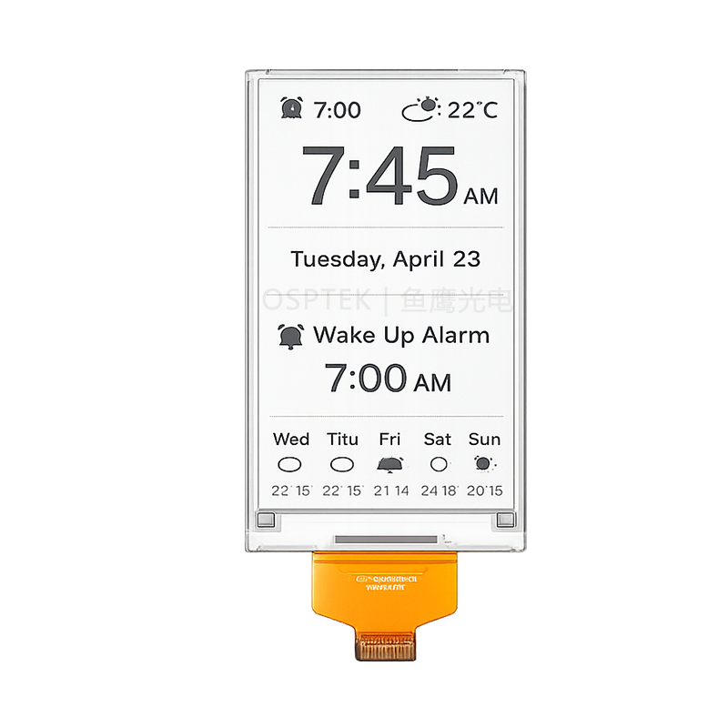

<p align="left"></p>

<h1 align="center">OSPTEK 4.26″ EPD Display 480×800 (EPD0426A02)</h1>

<p align="center"><b>EPD module · SPI · SSD1677</b></p>

<p align="center"><a href="./README.md">简体中文</a> | English · <a href="../../README_EN.md">Family index</a></p>

<p align="center">
  
  
</p>

<p align="center"></p>

## Contents

- [Specifications](#specifications)
- [Resources](#resources)
- [Repository layout](#repository-layout)
- [Buy](#buy)
- [Support](#support)

---

## Specifications

| Item | Spec |
| ---- | ---- |
| Size | 4.26 inch |
| Type | EPD |
| Resolution | 480×800 |
| Outline | 62.37 x 105.33 x 0.85 mm |
| Active area | 55.68 x 92.8 mm |
| Interface | SPI |
| Driver IC | SSD1677 |
| Touch IC | — |

> Full outline, FPC definition, power, and timing follow the product datasheet / driver IC datasheet.

## Resources

| Category | File |
| ---- | ---- |
| Datasheet | [`SSD_1677_447731c055.pdf`](./datasheets/SSD_1677_447731c055.pdf) |
| Datasheet | [`EPD0426A02.pdf`](./datasheets/EPD0426A02.pdf) |
| Adapter materials | [`2.jpg`](./adapter/2.jpg) |
| Adapter materials | [`4.26寸墨水屏转接板V1.1.pdf`](./adapter/4.26%E5%AF%B8%E5%A2%A8%E6%B0%B4%E5%B1%8F%E8%BD%AC%E6%8E%A5%E6%9D%BFV1.1.pdf) |

## Repository layout

```text
display-epd-4.26inch-480x800/ # repo root (nav: ../../README_EN.md; sample projects under root examples/)
└── versions/
    └── EPD0426A02/        # full materials for this part number
        ├── README.md
        ├── README_EN.md
        ├── osptek.yml
        ├── images/
        ├── datasheets/       # product datasheet + driver/touch IC datasheets
        └── adapter/          # adapter board materials + photos
```

## Buy

See the [repo home page](../../README_EN.md#where-to-buy).

## Support

See the [repo home page](../../README_EN.md#support).

---

<p align="center"><sub>© 2026 OSPTEK · Materials in this repository are licensed under CC BY 4.0</sub></p>
